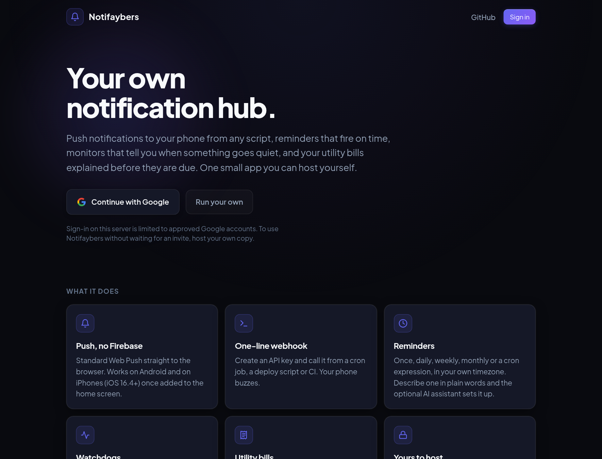
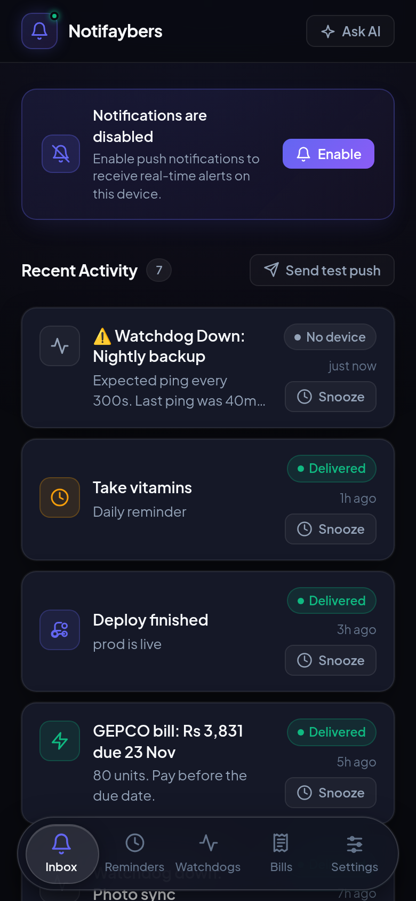
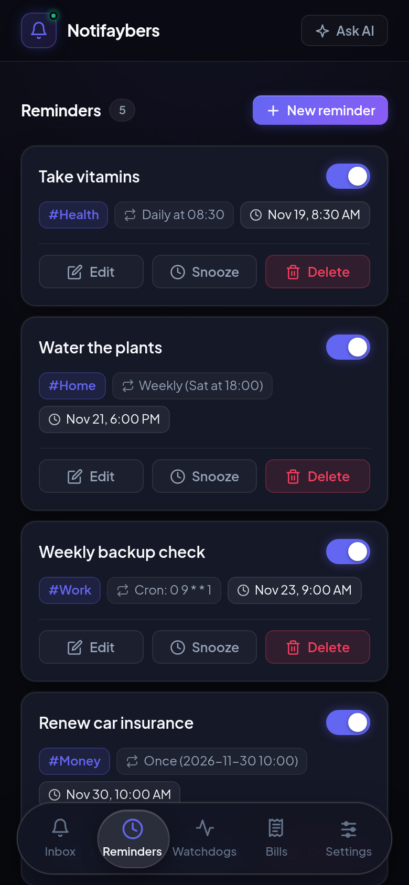
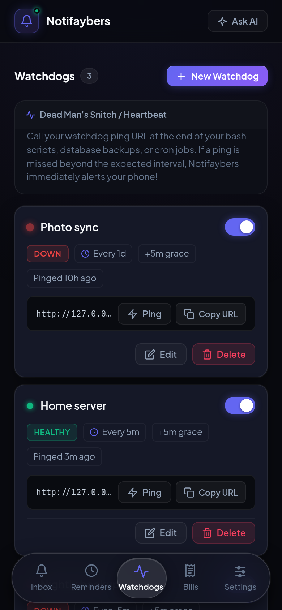
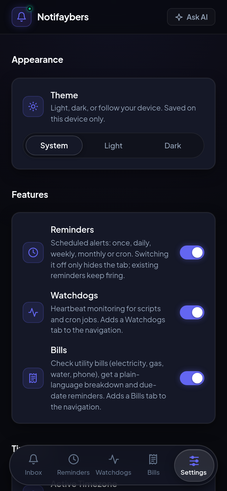
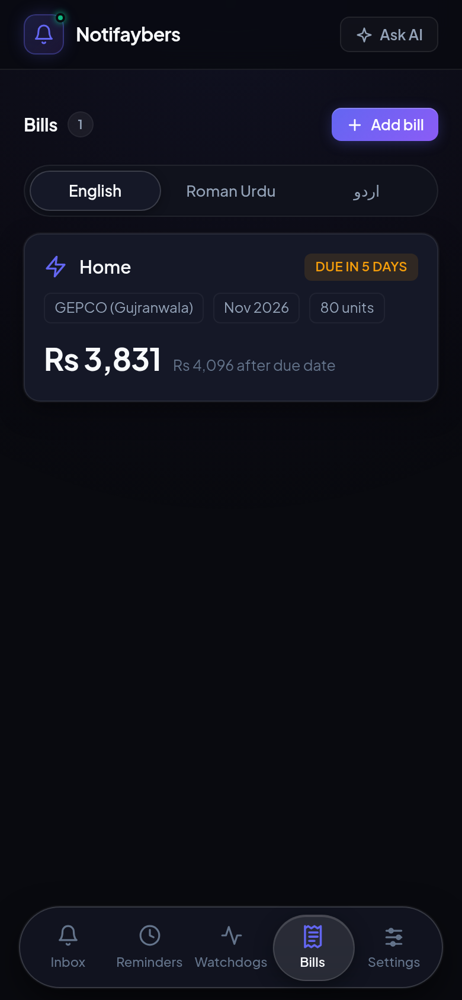
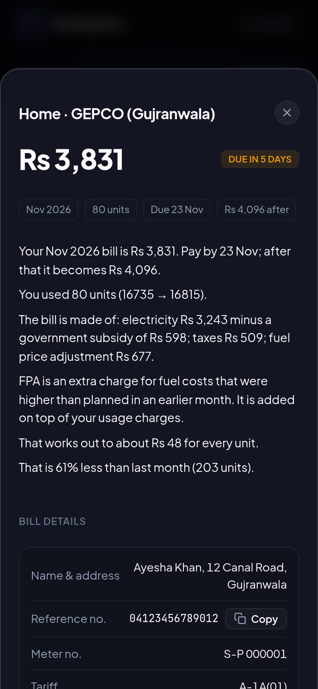
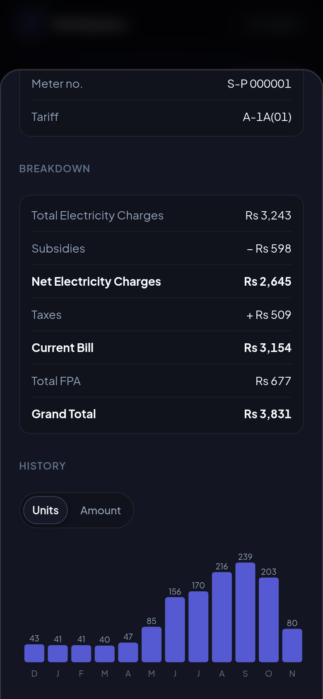

# Notifaybers

Personal notification hub: Google sign-in, Web Push (no FCM
needed — works on iOS 16.4+ home-screen apps and on Android), a webhook
for other projects to call, cron-like reminders, watchdog heartbeat monitors
and an optional AI assistant. Light and dark themes.

## Screenshots

<p align="center">
  
</p>

<p align="center">
  
  
  
  
</p>

<p align="center">
  
  
  
</p>

*The screenshots use made-up data. The bill is a redacted test fixture.*

## Quick start

```bash
git clone https://github.com/Hanzla-Double3/notifaybers.git && cd notifaybers
python3 scripts/setup.py
```

The setup script asks for everything the app needs and says where to find
each value (including a step-by-step for the Google OAuth client). It then:

- writes `.env` (mode 600; an existing one is backed up and its values are
  offered as defaults),
- generates `SECRET_KEY` and the Web Push (VAPID) key pair in `data/`,
- for **local development**: creates `.venv`, installs dependencies and can
  start the app on `http://localhost:8000` (with an optional no-Google login
  shortcut),
- for a **server**: builds and starts the Docker container and prints the
  Caddy snippet for your domain.

It is safe to re-run: your secret key and push keys are kept (replacing them
would sign everyone out and force devices to re-subscribe). Needs Python 3.9+,
plus Docker for server mode and `openssl` or the `cryptography` package for the
push keys. The sections below explain what each setting does if you'd rather
configure by hand.

## 1. Configure by hand

```bash
cp .env.example .env
python3 -c "import secrets; print(secrets.token_hex(32))"   # -> SECRET_KEY
```

(`scripts/setup.py` does all of this for you.) Fill in `.env`:
- `SECRET_KEY` — random value from above.
- `ADMIN_USERNAME` — name of the account seeded on first startup. There is no
  password login; see "Sign in with Google" below.
- `DEFAULT_TIMEZONE` — e.g. `Europe/London`. Changeable per-account later
  from Settings.
- `VAPID_SUBJECT` — a `mailto:` address, any valid email.
- `PUBLIC_BASE_URL` — the public origin, e.g. `https://notify.yourdomain.com`
  (no trailing slash). Shown in Settings' webhook cURL snippet and used
  for watchdog ping URLs. If empty, the origin of the current request is
  used, which behind a proxy may be `http://` or an internal host.
- `WATCHDOG_MIN_PING_SECONDS` — admin-set floor for watchdog ping
  intervals (default and minimum 60). Not editable from the UI.

## Sign in with Google

Sign-in is Google only.

1. https://console.cloud.google.com/apis/credentials → Create credentials →
   OAuth client ID → type **Web application**. (If asked, set up the OAuth
   consent screen first: External, add yourself as a test user, or publish it.)
2. Under **Authorized redirect URIs** add
   `<PUBLIC_BASE_URL>/auth/google/callback`, e.g.
   `https://notify.yourdomain.com/auth/google/callback`. For local work also
   add `http://localhost:8000/auth/google/callback`.
3. Put the client ID and secret in `.env` as `GOOGLE_CLIENT_ID` /
   `GOOGLE_CLIENT_SECRET`.
4. Set `ADMIN_EMAIL` to your Google address. On your first sign-in it links to
   the existing `ADMIN_USERNAME` account, so your reminders, API keys and
   devices carry over.
5. Other people: add their Google emails to `ALLOWED_EMAILS` (comma-separated),
   or set `OPEN_SIGNUP=true` to let any verified Google account sign up. The
   list is checked on every sign-in; removing an email locks that account out.

Do the Google setup *before* deploying this version: with no Google client
configured, the login page has no way in.

### Local development without Google

Set `DEV_AUTO_LOGIN=true` in your local `.env`. Opening `/login` from the same
machine then signs you in as `ADMIN_USERNAME` automatically. It only applies to
direct loopback connections; never enable it on the server.

## 2. Generate VAPID keys (once)

(Done by `scripts/setup.py`.)

```bash
mkdir -p data
pip install -r requirements.txt   # or run this inside the container later
python scripts/gen_vapid.py
```

Copy the printed `VAPID_PUBLIC_KEY=...` line into `.env`. The private
key is saved to `data/vapid_private.pem` — keep that file, it's what
lets your server sign pushes. Losing it means every device has to
re-subscribe.

## 3. Icon

Your bell icon is already placed and resized at:
`app/static/icons/{icon-192,icon-512,icon-maskable-512,apple-touch-icon,favicon-32,favicon-16}.png`

## 4. Run with Docker

```bash
docker compose up -d --build
```

Runs on `127.0.0.1:8000`. **Only one worker** — the reminder scheduler
runs in-process, so more workers would fire reminders multiple times.

## 5. Point Caddy at it

Since Caddy already runs on your VPS, add a site block (adjust the
domain):

```
notify.yourdomain.com {
    reverse_proxy 127.0.0.1:8000
}
```

Reload Caddy: `caddy reload` (or however your setup applies config).
Web Push and service workers require HTTPS — Caddy handles the
certificate automatically via its default ACME setup.

If Caddy itself runs in Docker, instead put both containers on the
same Docker network and remove the `ports:` mapping in
`docker-compose.yml`, then `reverse_proxy notifaybers:8000`.

## 6. First login

Visit `https://notify.yourdomain.com/login` and choose Continue with Google. A modal will prompt you to enable
notifications:
- **Android / desktop**: tap Enable, grant permission, done.
- **iOS**: Safari → Share → Add to Home Screen first (push only works
  from the installed app, not the Safari tab). Open it from the Home
  Screen icon, then enable notifications.

## Webhook usage (from your other projects)

Create an API key from Settings, then:

```bash
curl -X POST https://notify.yourdomain.com/api/webhook \
  -H "X-API-Key: nfb_xxx" \
  -H "Content-Type: application/json" \
  -d '{"title": "Deploy finished", "body": "prod is live", "url": "https://dash.example.com"}'
```

Rate limited to `WEBHOOK_RATE_LIMIT_PER_MINUTE` (default 30) requests
per minute per key.

## Watchdogs

Off by default. Turn them on in Settings → Features; the Watchdogs tab then
appears in the navigation. Each watchdog gets a ping URL
(`/api/ping/<token>`) — hit it from a script or cron job, and you get a
push if it goes quiet for longer than interval + grace. Existing
watchdogs keep being monitored even if the feature is switched off again.

## Bills

Off by default. Turn it on in Settings → Features and a Bills tab appears. Pick your
company (electricity, gas, water, phone), enter the number printed on your bill, and
Notifaybers fetches the bill and shows the amount, due date, the customer name and
address, the reference number (with a Copy button for pasting into your bank app), a
12-month history and a plain-language breakdown in English, Roman Urdu or Urdu. It can
also share the bill as an image.

Each day at 8 am (your timezone) it checks only when a new bill is expected, using
that company's usual publish day, and sends a push when one arrives. The day before
the due date it sends a reminder (and says if the portal shows the bill unpaid).

Companies are plugins: one file per company in `app/bills/adapters/`. Anyone can add
one; see [docs/ADAPTERS.md](docs/ADAPTERS.md) and [CONTRIBUTING.md](CONTRIBUTING.md). If a company's portal asks for a CAPTCHA,
the app shows it to you and you type it; it never solves one for you. Bill data is
fetched from the company's own public portal and is only as reliable as that portal.

## Home page and admin

Visitors who are not signed in see a public home page at `/` (what the app does, a
Sign in button, a link to the source). Signed-in users get the app at the same address.

The account named by `ADMIN_USERNAME` / `ADMIN_EMAIL` is marked as an admin
(`is_admin` on the user row; setting those values only ever promotes an account, it never
demotes one). Admins get **Settings → Admin → Users**: a paginated list of everyone who
has signed up, with their email and when they were last active. Nobody else sees the
link, and `/admin/users` sends them back to Settings. "Last active" is updated when
someone opens or uses the app, at most once every five minutes.

## Theme

Settings → Appearance: System (default), Light or Dark. Stored per
device in the browser.

## Reminders

Create from the Reminders tab: once, daily, weekly, monthly (on a
day-of-month, clamped to the last day for short months — e.g. day 31
fires on Feb 28/29), or a raw cron expression. All run in your
account's timezone (Settings).

## Redeploying

Not automatic: pushing to GitHub does nothing by itself. (First-time setup
on the server is `python3 scripts/setup.py`; this is for shipping updates.) Copy
`.deploy.env.example` to `.deploy.env` (git-ignored), fill in your server and
domain, then from your local machine:

```bash
./scripts/deploy.sh
```

It SSHes in, pulls `origin/master`, rebuilds, and checks that `/login` comes
back 200. `.env` and `data/` are gitignored and untouched by any of this. On
the server it boils down to:

```bash
cd /opt/notifaybers
git fetch origin
git reset --hard origin/master   # NOT `checkout -f` — that does not move the branch pointer
docker compose up -d --build
```

If the repo is private, give the server a read-only deploy key so it can pull.

### Auto-deploy with blue-green (Podman + Caddy)

`deploy/bluegreen.py` is an alternative that deploys every push to `master` by itself
with no downtime. It needs Python 3, Podman, git and a running Caddy container, and
nothing else (standard library only).

How it works: there are two slots, `blue` and `green`, each its own container on its
own loopback port. A watcher polls the git remote every minute. For a new commit it
builds the image, starts it in the idle slot, waits for `/healthz`, runs a smoke test,
then points Caddy at it with a graceful reload and stops the old slot. If anything
fails before the switch, the live slot is never touched and that commit is not
retried. The stopped old slot is kept, so `rollback` is instant.

Only one copy runs the reminder scheduler at a time (a lock file in `data/`), so a
reminder never fires twice while both copies are up; the new copy takes over the
moment the old one stops.

Setup on the host (once), with everything under `/opt/notifaybers`:

```
shared/.env           # your .env (SESSION_SECURE_COOKIE=true, PUBLIC_BASE_URL=https://your.domain)
shared/data/          # the database and VAPID key
shared/ssh/deploy_key # read-only deploy key if the repo is private
shared/deploy.env     # DOMAIN, CADDY_CONTAINER, CADDY_SNIPPET, BLUE_PORT, GREEN_PORT, BRANCH
repo/                 # git clone of this repository
```

`CADDY_SNIPPET` is a file your Caddyfile pulls in with `import`; the script owns it
and rewrites it on every switch. Then:

```bash
python3 /opt/notifaybers/repo/deploy/bluegreen.py deploy   # first deploy
python3 /opt/notifaybers/repo/deploy/bluegreen.py watch    # run at boot; auto-deploys pushes
python3 /opt/notifaybers/repo/deploy/bluegreen.py status
python3 /opt/notifaybers/repo/deploy/bluegreen.py rollback
```

Logs: `/var/log/notifaybers-deploy.log` (watcher and deploys). Each app copy's own
output is `podman logs notifaybers-blue` / `notifaybers-green`.

## Notes / accepted tradeoffs

- Sign-in is Google only. Every table is scoped by `user_id`, so more people
  can be allowed in with `ALLOWED_EMAILS` / `OPEN_SIGNUP` without schema changes.
- No CSRF token system — relies on the session cookie's `SameSite=Lax`,
  which already blocks cross-site POSTs from carrying the cookie.

## License

[WTFPL](LICENSE): do whatever you want.
